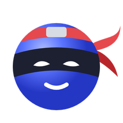
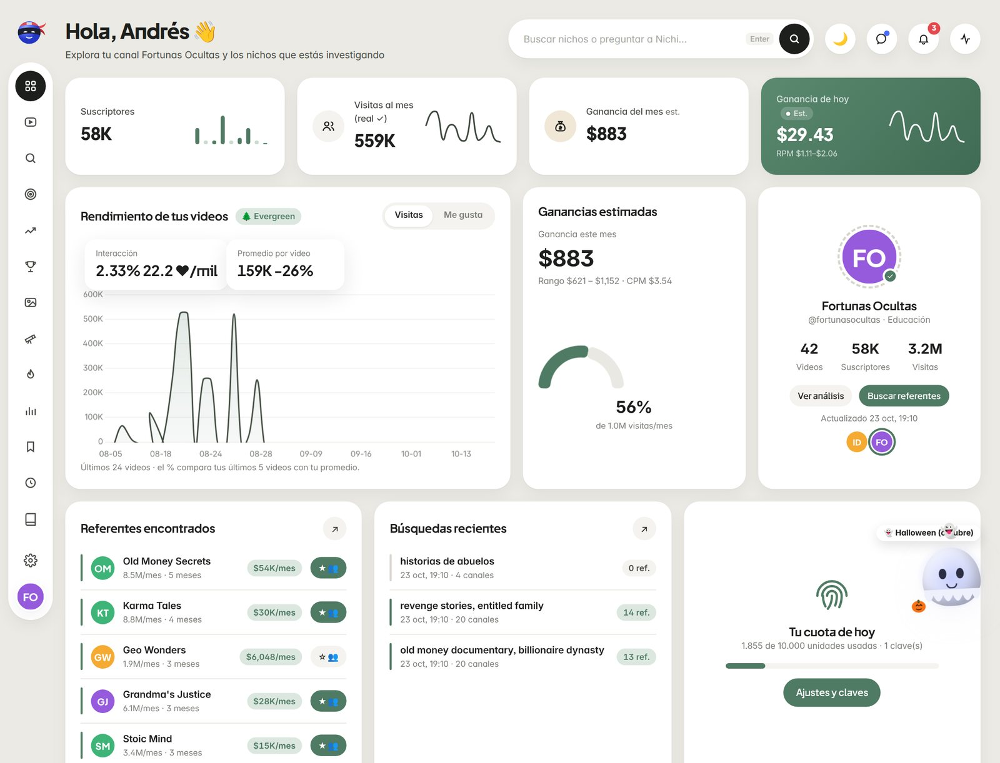
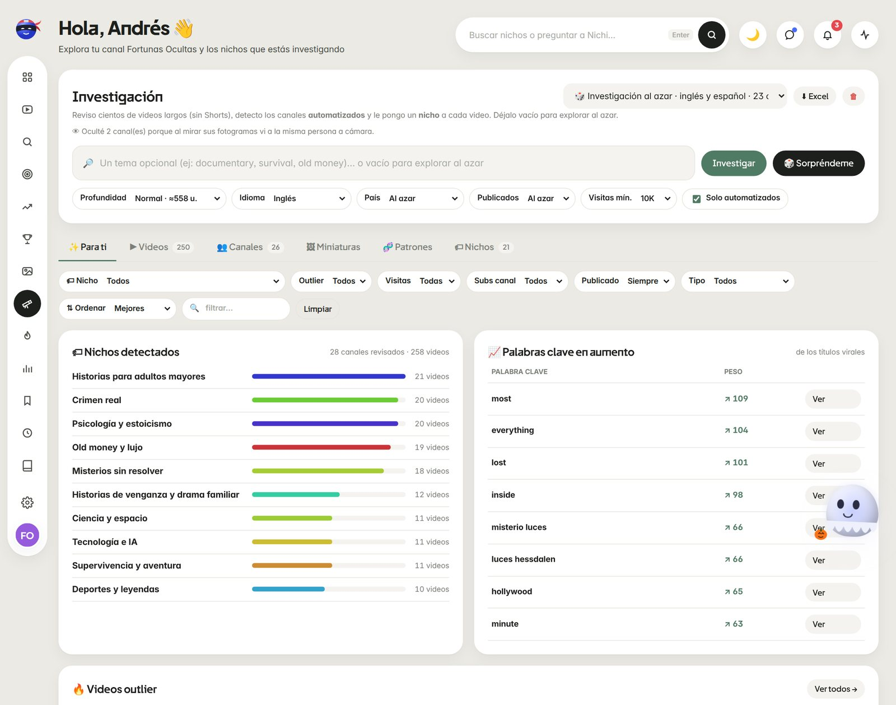
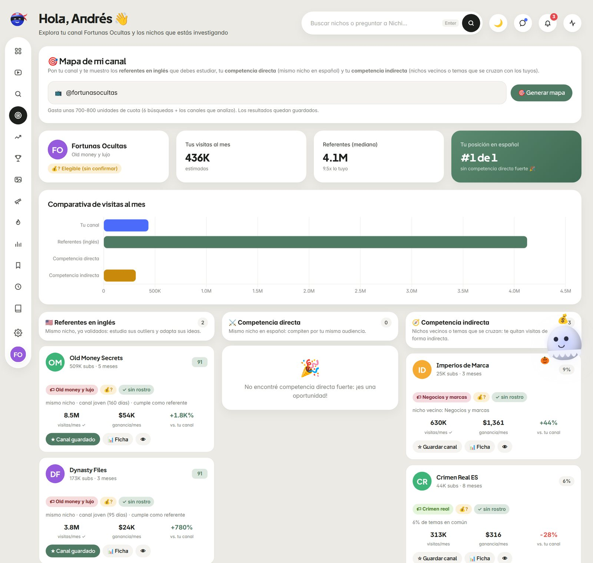
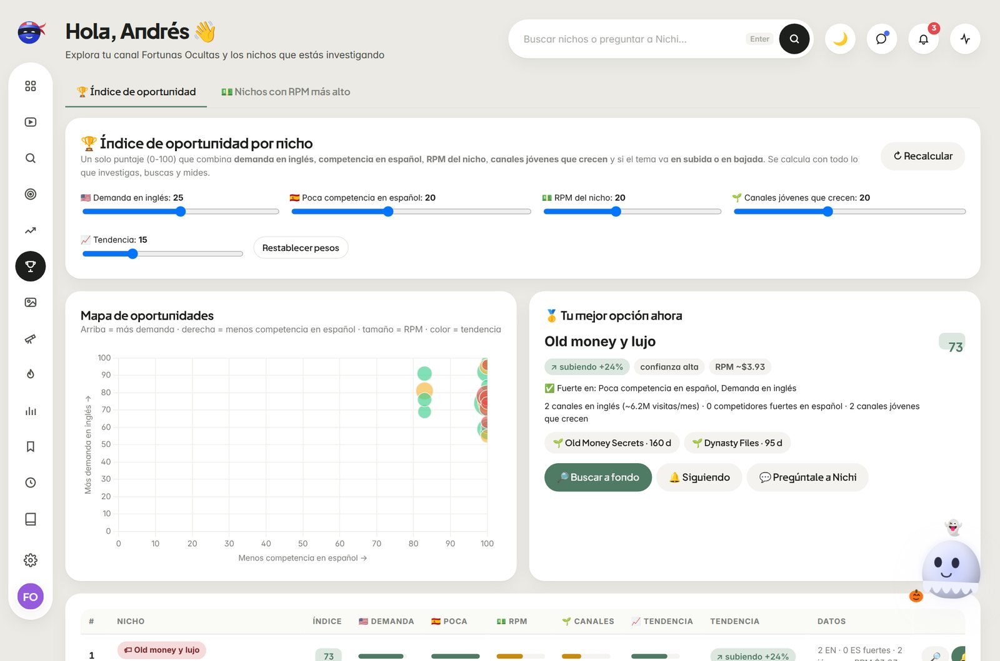
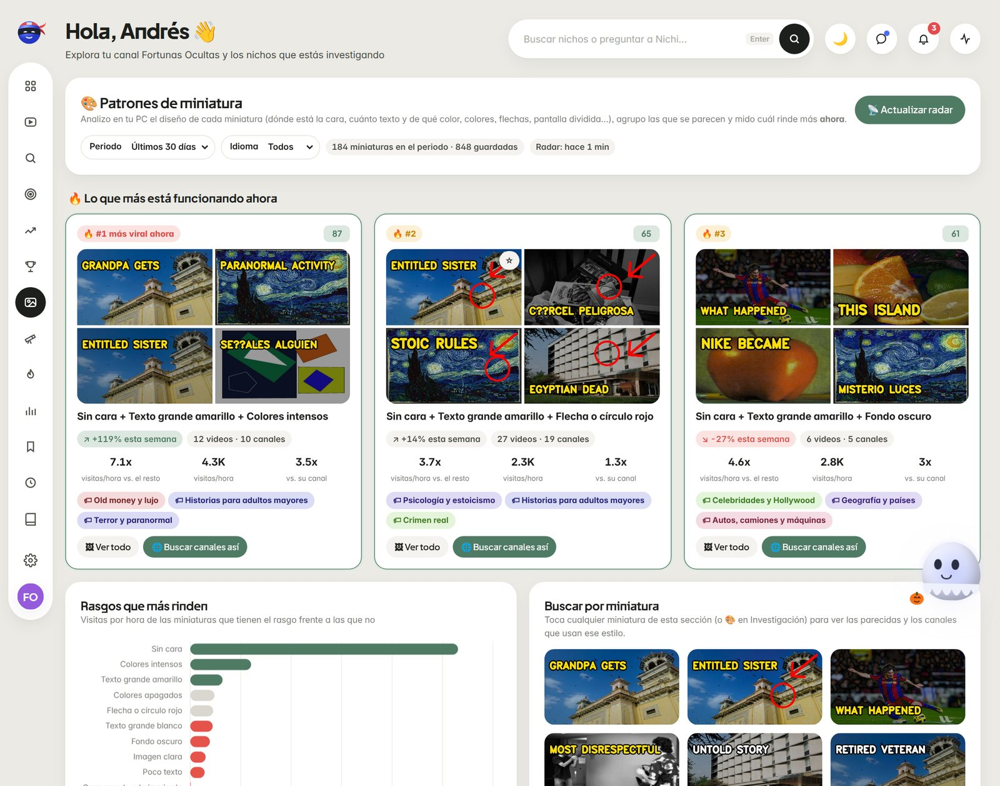
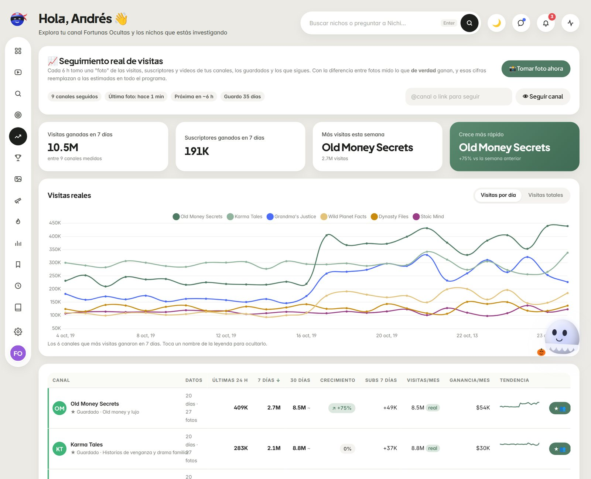
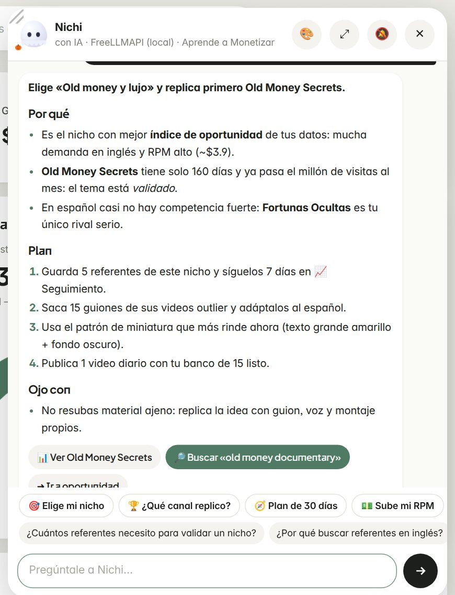
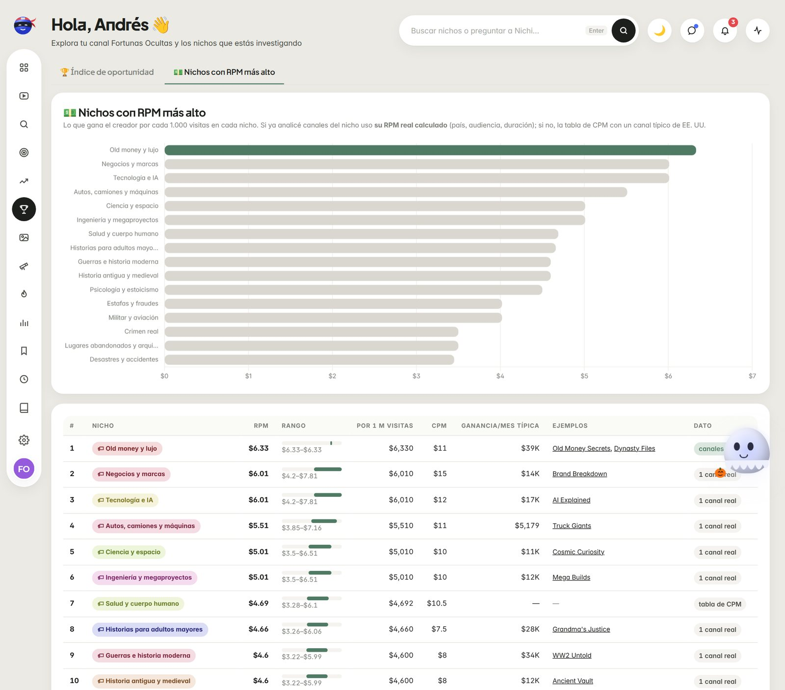
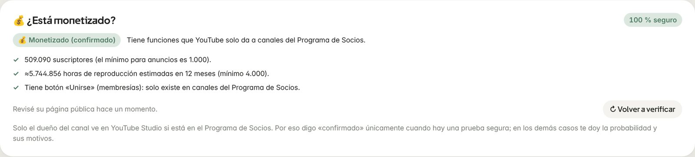

<div align="center">



# NichosForge Pro

**Find, validate and track profitable niches for faceless (automated) YouTube channels — with real data and an AI strategist.**

[Español](README.es.md) · [User guide (PDF, Spanish)](docs/Guia_de_uso_NichosForge_Pro.pdf) · [Changelog](CHANGELOG.md)




</div>

---

## What is it?

NichosForge Pro is a **local web panel** (it runs on your PC at `http://127.0.0.1:8767`) that helps you pick the right niche for a
faceless YouTube channel. It finds English channels that already work, estimates and **measures** how much they earn, checks whether they
are really faceless and monetized, recognizes the thumbnail patterns that are going viral right now, and tells you which niche to copy in
Spanish — following the *Aprende a Monetizar* (“Learn to Monetize”) methodology.

It comes with **Nichi**, a ninja mascot and AI strategist that reasons with your data, compares options and **picks one**, with a concrete plan.

> The UI and the assistant speak Spanish. The code, data model and this README are documented so anyone can contribute.

## Features

| | Feature | What it does |
|---|---|---|
| 🔭 | **Investigation** | Scans hundreds of long videos (no Shorts) from trends and broad searches, detects automated channels and labels each video with a niche. |
| 🔎 | **Explore** | Searches niches by phrase (English = referents, Spanish = competition) and analyzes every channel: type, role, health, audience, views, earnings. |
| 🎯 | **My channel map** | Enter your channel and get **English referents**, your **direct competition** (same niche in Spanish) and **indirect competition** (neighbor niches / overlapping topics), plus content gaps. |
| 🏆 | **Niche opportunity index** | One 0-100 score: demand in English, competition in Spanish, niche RPM, young growing channels and trend (up/down). Adjustable weights. |
| 💵 | **Highest-RPM niches** | Ranking by creator revenue per 1,000 views, using the real RPM of the analyzed channels in each niche. |
| 🚀 | **Referent outliers** | The videos that beat their own channel the most among your referents — with “Why did it work?” analysis. |
| 📈 | **Real view tracking** | Snapshots every 6 h → views actually gained in 24 h / 7 d / 30 d and weekly growth. Replaces estimates everywhere. |
| 🎨 | **Thumbnail patterns** | Local computer vision fingerprints each thumbnail (face, text, colors, arrows, split screen), groups them into named patterns and ranks what is viral **now**. “Similar” search from any thumbnail. |
| 👁 | **Faceless verification** | Looks at the thumbnail and 3 frames inside each video **on your PC** (OpenCV YuNet + SFace) to confirm whether the same person appears on camera. |
| 💰 | **Monetization checker** | Says “confirmed” only with hard proof (Join / Super Thanks buttons, or < 1,000 subscribers); otherwise gives a probability with reasons. |
| 🔔 | **Automatic alerts** | Daily check of your channels and followed niches: new outliers and young channels that explode. Desktop notifications. |
| 🧬 | **Patterns** | What repeats in winning videos: title formulas, title types, repeated ideas across channels, tags and SEO. |
| 🏷 | **Niche classifier** | Channel-first classification with weighted rules, tie-breakers, an AI review of doubtful channels and a local model that learns from your corrections. |
| 🧠 | **Nichi (AI strategist)** | Decision framework + pre-computed analysis; answers with a decision, reasons, plan, risks and clickable actions. Works without AI too. |
| 🔑 | **Multiple YouTube keys** | Automatic key rotation when one runs out of quota; retries on network errors. |
| 🌗 | **Light / dark theme** | Dark mode with red accents, seasonal mascot costumes, animations. |

<details>
<summary><b>Screenshots</b></summary>

| | |
|---|---|
|  |  |
|  |  |
|  |  |
|  |  |

</details>

## Quick start

### Requirements
- **Python 3.10+** (tested on 3.12)
- A free **YouTube Data API v3** key → [Google Cloud Console](https://console.cloud.google.com/apis/library/youtube.googleapis.com)
- Optional (recommended): a free AI key — **Gemini** ([AI Studio](https://aistudio.google.com/apikey)), **Groq**, or a local **FreeLLMAPI**. Claude and OpenAI are also supported.

### Windows
1. Download or clone the repository.
2. Double-click **`instalar_actualizar.bat`** (installs dependencies, including OpenCV).
3. Double-click **`iniciar_panel.bat`** — the panel opens at `http://127.0.0.1:8767`.
4. In **Ajustes** (Settings) paste your YouTube key(s) and, optionally, an AI key.

### macOS / Linux
```bash
git clone https://github.com/<your-user>/nichosforge-pro.git
cd nichosforge-pro
python3 -m venv .venv && source .venv/bin/activate
pip install -r requirements.txt
cp .env.example .env        # optional: you can also paste keys from the panel
python main.py panel
```

### Commands
```bash
python main.py panel                # open the panel (default port 8767)
python main.py panel --no-abrir     # start without opening the browser
python main.py panel --puerto 9000  # use another port
python main.py limpiar              # wipe local data (keeps settings and keys)
```

## Configuration

Keys live in **`.env`** (never committed). See [`.env.example`](.env.example):

| Variable | Purpose |
|---|---|
| `YOUTUBE_API_KEY`, `YOUTUBE_API_KEY_2…` | YouTube Data API v3 keys (rotated automatically) |
| `GEMINI_API_KEY` / `GROQ_API_KEY` / `FREELLMAPI_KEY` | Free AI providers (failover chain) |
| `ANTHROPIC_API_KEY` / `OPENAI_API_KEY` | Paid AI providers (optional) |

Everything else (CPM per niche, country factors, alert thresholds, theme…) is editable in **Ajustes** and stored in `datos/ajustes.json`.

### Quota cost (YouTube Data API, 10,000 units/day per key)

| Action | Approx. units |
|---|---|
| Explore search (per phrase) | 100 + ~2 per analyzed channel |
| Investigation quick / normal / deep | ~200 / 560 / 1,030 |
| My channel map | ~700-800 |
| Thumbnail radar (auto every 6 h) | ~40 |
| Real tracking | 1 per 50 channels, every 6 h |
| Alerts | 1 per followed channel + 102 per followed niche, daily |
| Faces, thumbnails, patterns | **0** (computed locally) |
| Repeating anything within 24 h | **0** (cache) |

## How it works

```
┌──────────────┐   HTTP (JSON)   ┌────────────────────────────────────────────────────┐
│  ui/index.html│ ◀────────────▶ │ server.py (stdlib http.server, port 8767)          │
│  vanilla JS   │                 │  core/motor.py      jobs: search, investigation,   │
│  + Chart.js   │                 │                     map, radar, referents          │
└──────────────┘                 │  core/youtube.py    API client · key rotation · cache│
                                  │  core/analisis.py   metrics · CPM/RPM · automation │
                                  │  core/clasificador  niche classifier + local NB    │
                                  │  core/cerebro.py    opportunity index · RPM ranking│
                                  │  core/rostros.py    YuNet + SFace (OpenCV)         │
                                  │  core/miniaturas.py thumbnail fingerprints/patterns│
                                  │  core/seguimiento   real-view snapshots + scheduler│
                                  │  core/alertas.py    daily alerts                   │
                                  │  core/monetizado.py monetization checker           │
                                  │  core/bot.py · llm.py  Nichi + AI provider failover│
                                  └───────────────┬────────────────────────────────────┘
                                                  ▼
                                   datos/*.json  (local storage, git-ignored)
```

- **No framework, no database**: Python standard library HTTP server + JSON files with an in-memory cache.
- **Local-first**: your data and keys never leave your machine (except calls to YouTube and to the AI provider you choose).
- **Background tasks**: face verification, thumbnail cataloging and alerts run in background threads and never block new searches.

## Project structure

```
nichosforge-pro/
├── main.py                 entry point (python main.py panel)
├── server.py               HTTP server and REST endpoints
├── core/                   all the logic (see "How it works")
├── ui/index.html           single-page app (HTML + CSS + JS)
├── ui/vendor/chart.umd.js  Chart.js 4 (MIT), bundled for offline use
├── modelos/                YuNet face detector (BSD-3); SFace is downloaded on first use
├── datos/                  your local data (git-ignored)
├── docs/                   user guide (PDF) and screenshots
├── iniciar_panel.bat       Windows launcher
└── instalar_actualizar.bat Windows installer/updater
```

## Accuracy, limits and honest notes

- **Estimates vs. real data**: monthly views and earnings are estimates until the real tracking has at least one day of snapshots (marked “real” ✓ afterwards). RPM/CPM are approximations by niche, country, audience, video length and season.
- **Monetization**: no public data says with 100% certainty whether a channel is in the YouTube Partner Program. The checker only says “confirmed” with hard proof; otherwise it reports a probability.
- **Faceless detection**: uses public thumbnails and auto-generated frames; recurring celebrities in documentary niches may be flagged as “doubtful”.
- **Niche classifier**: ~100% at channel level in our tests; individual titles can be ambiguous (the channel's niche is inherited).

## Compliance

- Uses the official **YouTube Data API v3**; you are responsible for complying with the [YouTube API Services Terms](https://developers.google.com/youtube/terms/api-services-terms-of-service). Real-view snapshots are kept **35 days** by default.
- Reading public YouTube **pages** (used only to *confirm* monetization) is **disabled by default**: YouTube's Terms of Service restrict automated access to their website. Enable it at your own responsibility.
- Thumbnails are downloaded from YouTube's public image CDN only to analyze them locally.
- This project is not affiliated with YouTube or Google.

## Contributing

Issues and pull requests are welcome — see [CONTRIBUTING.md](CONTRIBUTING.md). Please never include API keys, `.env` files or the `datos/` folder in issues or PRs.

## License

[MIT](LICENSE) © NichosForge Pro contributors. Third-party components are listed in [THIRD_PARTY_NOTICES.md](THIRD_PARTY_NOTICES.md).
